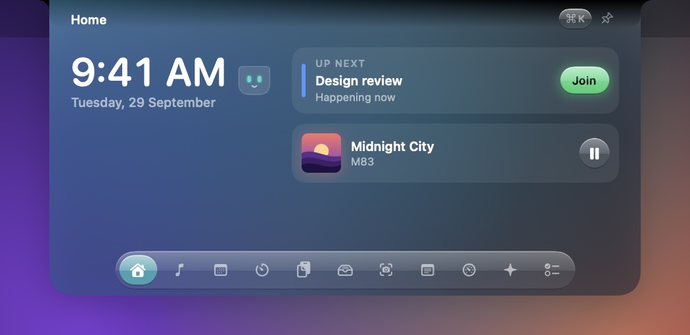
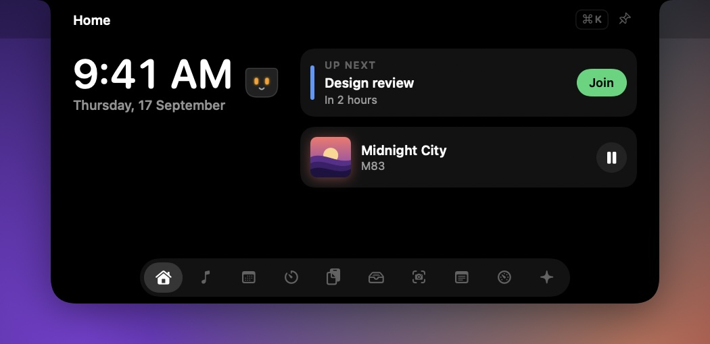
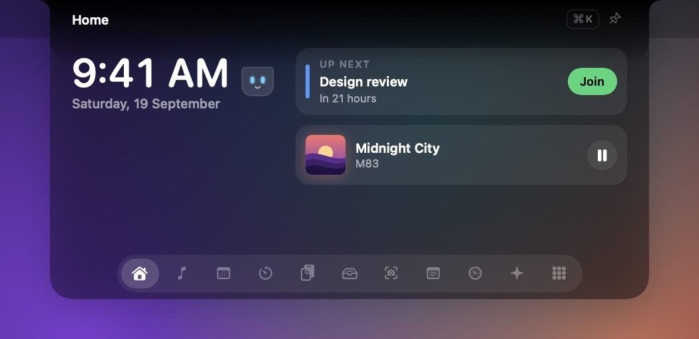
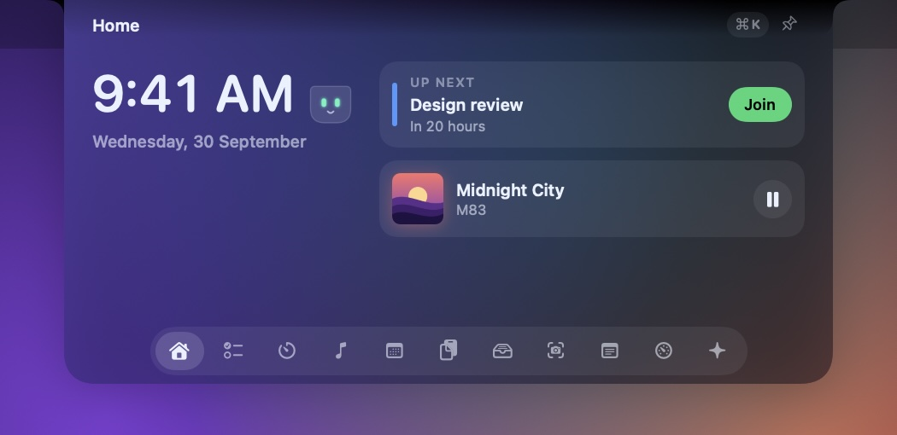

  

<h1 align="center">Xotch</h1>

  <strong>Your MacBook's notch, put to work.</strong> 
  Your to-dos, music, calendar, timers, screenshots and Claude Code, all one hover away.

  <a href="#get-the-beta"><strong>Get the beta</strong></a>
  &nbsp;·&nbsp;
  <a href="#everything-you-reach-for-in-one-place">Features</a>
  &nbsp;·&nbsp;
  <a href="#private-by-design">Privacy</a>
  &nbsp;·&nbsp;
  <a href="#questions">Questions</a>

  
  
  
  

  

## Quiet until you need it

Xotch lives in the notch and doesn't get in your way.

- **Peek:** move the pointer to the notch and it grows slightly.
- **Open:** keep the pointer there and Xotch opens.
- **Keep it open:** click, and it stays open until you press Esc or click somewhere else.

When the notch is closed and nothing's happening, Xotch uses no processor time at all.

## Live, right beside the camera

When something's happening, the notch grows two small "ears" to show it, without opening.

<table>
  <tr>
    <td align="center" width="50%"> <b>Focus timer:</b> a ring fills as time passes</td>
    <td align="center" width="50%"> <b>Music:</b> artwork and bars that can follow the real sound</td>
  </tr>
  <tr>
    <td align="center"> <b>Claude Code:</b> a soft pulse while it works; a faster one when it needs you</td>
    <td align="center"> <b>Screen recording:</b> the time so far; click it to stop</td>
  </tr>
  <tr>
    <td align="center"> <b>Downloads:</b> how far along they are</td>
    <td align="center"> <b>System HUD:</b> CPU, memory, network and battery as bars, when nothing else is live</td>
    <td align="center"> <b>Volume:</b> scroll on the notch to change it</td>
  </tr>
</table>

If more than one thing is live, the most important shows, and small dots tell you others are waiting. The **system HUD** (Settings › System HUD, off by default) always comes last, so a timer, recording or song takes its place, and it doesn't count as something waiting. It reads the stats every 2 seconds while it's on, and stops when a full-screen app hides the notch or your displays sleep.

## Everything you reach for, in one place

<table>
  <tr>
    <td width="33%"></td>
    <td width="33%"></td>
    <td width="33%"></td>
  </tr>
  <tr>
    <td valign="top"><b>Now Playing</b> Artwork, a dot-matrix track display and controls for Music, Spotify, your browser, or any other app playing audio.</td>
    <td valign="top"><b>Calendar</b> The next 7 days, one-click Join for Zoom, Google Meet and Teams, and reminders you can tick off.</td>
    <td valign="top"><b>Timers</b> Focus sessions with breaks, countdowns, and a stopwatch with laps.</td>
  </tr>
  <tr>
    <td></td>
    <td></td>
    <td></td>
  </tr>
  <tr>
    <td valign="top"><b>Clipboard</b> Everything you've copied, searchable and pinnable. Passwords from password managers are skipped.</td>
    <td valign="top"><b>Shelf</b> Drop files on the notch to keep them handy. Drag them out later, AirDrop them, or flick them away.</td>
    <td valign="top"><b>System</b> CPU, memory, network speed, disk space and battery health, updated only while you look.</td>
  </tr>
</table>

**Also inside:**
- **Home:** the time, your next meeting and what's playing.
- **Notes:** a scratchpad that can sit beside the notch, and notes that save as you type.

## To-dos

Today's to-dos, and a someday list for the rest.

- Type a to-do straight into the notch, or press ⌘K anywhere and say what you're doing.
- Right-click a to-do to move it to today, tomorrow or someday.
- Unfinished to-dos carry over to the next day rather than quietly disappearing.

## Screenshots and recordings

Take a screenshot of an area, a window or the whole screen, or record your screen with sound. It all lands on a shelf in the notch, ready to drag into a message.

The shelf picks up the screenshots you take with **⌘⇧3**, **⌘⇧4** and **⌘⇧5** too, so everything is in one place. Drag one out, AirDrop it, or flick it away.

Screenshots are copied to your clipboard as they're taken, and saved in **Pictures › Xotch**. Recording needs macOS 15.

 

## Claude Code, beside the notch

See today's tokens, replies and streak, read from Claude Code's logs on your Mac.

Add the hook, and each session shows whether it's working, needs you, or is done, right beside the camera. That means you can leave Claude running and get back to something else.

 

## Make it yours

<table>
  <tr>
    <td width="25%"></td>
    <td width="25%"></td>
    <td width="25%"></td>
    <td width="25%"></td>
  </tr>
  <tr>
    <td align="center"><b>Aero Glass</b> The default: glossy 2000s glass</td>
    <td align="center"><b>Midnight</b></td>
    <td align="center"><b>Smoke Glass</b> Liquid Glass on macOS 26</td>
    <td align="center"><b>Aurora</b></td>
  </tr>
</table>

- **Aero Glass** is Frutiger Aero, the glossy look of Windows Aero and early Mac OS X: a bright band across the top of every button, bevelled edges, aqua-green accents and rounded type, on top of Liquid Glass. The other themes stay flat, and a custom theme can turn the gloss on or off.
- **Arcade sound effects:** short 8-bit blips for opening and closing the notch, switching modules, adding, finishing and deleting to-dos, pinning, and a jingle for a finished timer or a celebration. They're generated in code, so nothing is bundled. Off by default: turn them on in Settings, with a volume slider.
- **Your own theme:** pick the background, text, accent and glow colours. The closed notch always stays black, so it blends in with the camera.
- **The mascot:** Xotch's little mascot lives on Home. It naps when things are quiet, thinks while you work, and jumps for joy when you finish a focus session.
- **Your modules, your way:**
  - Reorder or hide any module.
  - Choose how the notch opens: hover or click.
  - Choose which display it appears on — every screen by default. A display without a notch gets one drawn in its menu bar, sized to the screen, so an external monitor, an iMac, a Mac mini or a Studio all work.

## One shortcut for everything

Press **⌘K** in the open notch and type:

| Type | To |
|---|---|
| `cal` | Open Calendar |
| `10 min` | Start a 10-minute timer |
| `pause` | Pause the music |
| `shot` | Take a screenshot |
| Anything else | Add it to today's to-dos |
| `aurora` | Switch theme |
| Something you copied | Copy it again |

 

### Shortcuts and gestures

| To | Do this |
|---|---|
| Switch module | ⌘1–⌘9, or swipe sideways with two fingers |
| Change the volume | Scroll on the closed notch |
| Remove a file from the Shelf | Flick it upwards |
| Close | Esc, or click anywhere else |

## Private by design

- **No tracking:** no account, no analytics.
- **Stays on your Mac:** your clipboard history, notes, to-dos and files never leave your Mac.
- **Offline:** Xotch doesn't connect to any online service.
- **Screenshots and recordings:** saved on your Mac, in Pictures › Xotch unless you choose another folder. Nothing is uploaded.
- **Audio:** when the music bars follow the real sound, Xotch only measures how loud it is. Nothing is recorded.
- **Crash reports:** never sent automatically. If you choose to keep them, you decide whether to email one.

<b>What Xotch asks permission for, and when</b>

 

Xotch asks only when you use something that needs it.

| Permission | When | Why |
|---|---|---|
| Calendars and Reminders | You choose **Allow** in Calendar | Your events and reminders |
| Notifications | You start your first timer | Telling you when time's up |
| Paste from other apps (macOS 26) | You choose **Allow** in Clipboard | Keeping your clipboard history |
| System audio recording | You turn on real sound for the music bars | Measuring how loud the music is |
| Screen Recording | Your first screenshot or recording in Capture | Taking the picture. Choosing a window to record uses macOS's own picker instead, which needs no permission |
| Microphone | Only if you turn on Capture › Microphone | Recording your voice with the screen |
| Desktop folder (may be asked) | Opening Capture, if it's listing your ⌘⇧3 and ⌘⇧4 screenshots | Finding those screenshots. macOS saves them to Desktop unless you've changed it |
| Downloads folder | macOS may ask when you turn on download progress | Showing how far downloads have got |

Xotch never asks for Accessibility or Input Monitoring.

## Light on your battery

| When | Processor use |
|---|---|
| Closed, nothing happening | 0% |
| Closed, with music, Claude Code or a download beside it | 0% |
| Open, on any module | 0.6% or less |

Measured on a 14-inch MacBook Pro with an M5 Pro chip. Anything that only matters on screen, like system stats, pauses when you can't see it.

## Get the beta

Xotch is in private beta. If you have an invite:

1. Unzip the download and drag **Xotch** to your Applications folder.
2. Open Xotch. If macOS says it can't check the app, open **System Settings › Privacy & Security** and choose **Open Anyway**. Beta builds aren't signed yet; releases will be.
3. Move the pointer to the notch. Xotch lives in the menu bar and has no Dock icon.

**Requirements:**
- macOS 14 Sonoma or later, on Apple silicon or Intel. It's best on a MacBook with a notch.
- Liquid Glass needs macOS 26.
- Music bars that follow the real sound need macOS 14.2.
- Screen recording needs macOS 15. Screenshots work on all of them.

<b>Connect Claude Code</b>

 

- Usage stats work straight away, from Claude Code's logs on your Mac.
- For live status, press **Add hook** in the Claude Code module. Xotch backs up `~/.claude/settings.json`, then adds a small entry so Claude Code can tell Xotch what it's doing.
- **Remove hook** takes that entry out again.

## Questions

<b>The notch disappeared.</b>

Xotch steps aside while an app is full screen. To keep it, turn off **Settings › Display › Hide the notch while an app is full screen**.

<b>Now Playing is empty.</b>

Start playing something. If Xotch says Now Playing isn't available, choose **Try again**.

<b>My clipboard history is empty (macOS 26).</b>

Open Clipboard and choose **Allow**. Then set Xotch to always allow under **Paste** in **System Settings › Privacy & Security**.

<b>The music bars don't follow the music.</b>

Allow Xotch under **System Settings › Privacy & Security › Screen & System Audio Recording**, or turn real sound off in Settings to keep the built-in animation.

<b>I don't have a notch.</b>

Then Xotch draws one. On a Mac without a notch — an iMac, a Mac mini, a Studio, an older MacBook — and on any external monitor, it draws a notch in that screen's menu bar, sized to the screen, and everything works the same. By default every display gets one; **Settings › Display** can narrow that to a single screen.

<b>The notch slides across when I change desktop.</b>

macOS slides every window sideways as desktops change, and it won't let an app opt a window out — the notch is pinned to all desktops, and it still gets moved. It lands back in place when the animation finishes.

To stop it, turn on **System Settings › Accessibility › Display › Reduce motion**: desktops then change without the sliding animation.

<b>My screenshots only show the wallpaper.</b>

macOS hasn't given Xotch permission yet. Allow Xotch under **System Settings › Privacy & Security › Screen & System Audio Recording**, then quit Xotch and open it again.

<b>Where do my screenshots go?</b>

To **Pictures › Xotch**, and to your clipboard. Choose another folder in **Settings › Capture**, or press **Open Folder** in the Capture module.

<b>I don't see download progress.</b>

Turn on **Settings › Show download progress**. Progress appears for apps that report it to macOS, such as Safari and Chrome.

<b>⌘K or ⌘1–9 does nothing.</b>

Click the notch first, so Xotch receives your keyboard input.

<b>macOS asked for Calendar access again after an update.</b>

Beta builds aren't signed yet, so macOS can ask again. Signed releases won't.

<b>How do I uninstall Xotch?</b>

1. If you added the Claude Code hook, press **Remove hook** in the Claude Code module.
2. Quit Xotch from the menu bar icon and move it to the Trash.
3. To remove everything else as well:
   - delete `~/Library/Application Support/Xotch` and `~/Library/Preferences/com.pranava.xotch.plist`

## Feedback

Choose **Send Feedback…** from the menu bar icon. It opens an email with your Xotch and macOS versions filled in.

 

Building Xotch from source? See <a href="docs/DEVELOPMENT.md">docs/DEVELOPMENT.md</a>.

