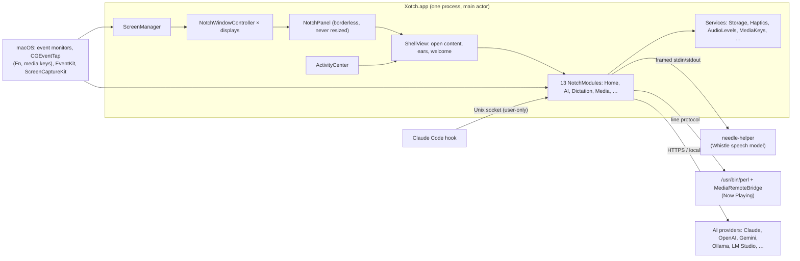

# Xotch engineering

How Xotch is built, why it's built that way, and the rules that keep it fast, private and debuggable. Read this before changing anything structural. For day-to-day commands, see [DEVELOPMENT.md](DEVELOPMENT.md). For numbers, see [PERFORMANCE.md](PERFORMANCE.md). For checks, see [TESTING.md](TESTING.md).

**At a glance:**
- **Code:** Swift 6 with strict concurrency, SwiftUI and AppKit, about 23,500 lines in 89 files.
- **Platform:** macOS 14 or later, Apple silicon and Intel. Dictation needs Apple silicon and macOS 26.
- **Dependencies:** no Swift packages. One vendored C library, Cactus's needle engine (Apache 2.0), is pinned by revision and checksum and used only by the dictation helper.

## Principles

These decide most arguments before they start.

1. **Idle costs nothing.**
   - A closed, quiet notch measures 0.00% CPU and 0 wakeups.
   - Anything that runs continuously is a Core Animation layer, so the window server animates it, never SwiftUI frame by frame.
   - Anything that samples runs only while it's on screen.
2. **Measure, don't guess.**
   - Every performance claim in the docs comes from `top`, `sample`, `footprint` or `scripts/perf.sh`, with the method written down.
   - Every UI bug is reproduced with the app's own instrumentation (`debug.sh status`, the self-test, a screen capture) before a fix is proposed.
3. **Nothing leaves the Mac unless the person chose it.**
   - There's no account, analytics or telemetry.
   - Network traffic goes only to the AI provider the person configured, plus a one-time download of the speech model.
   - Anything that changes their data or shares it with a model waits for an explicit Allow.
4. **Debuggable without a mouse.** Every state can be driven and read from `scripts/debug.sh`: open, click, type, status, the self-test, snapshots. If a change can't be verified that way, add the hook first.
5. **Native and small.**
   - Nothing that needs a runtime, a web view or a package manager.
   - Where macOS restricts something, a small helper process does exactly that job and nothing else (see below).

## System at a glance

## The shell

- **One panel per display, sized once.**
  - `NotchPanel` is a borderless, non-activating panel sized for the largest state any module can ask for (`Layout.panelSize`), and never resized.
  - Resizing windows on every state change was the main source of jank and CPU in early builds. Now each state change is one spring on one shape (`NotchShape` animates its shoulder and corner radii).
  - The panel ignores the mouse except over the notch shape, so clicks elsewhere reach the apps underneath.
- **A small state machine per display.**
  - `NotchWindowController` runs closed → peek → open, plus pinned.
  - `ScreenManager` feeds it pointer movement from app-wide event monitors, so no extra permission is needed. It also owns cross-display concerns: the primary display, full-screen detection, and the welcome.
- **"Activity" is derived, not a phase.**
  - A closed or peeking notch grows ears whenever `ActivityCenter` has something:
    - a HUD shows at once;
    - banners show one at a time;
    - ongoing activities take turns every 6 s, unless they're sticky (a recording, Claude waiting for you).
  - The ears fit their content exactly. `EarMetrics` measures text with the same font SwiftUI uses, rounded up, which matches layout to the point, and re-fits when a running clock gains a digit.
- **Modules.**
  - Each feature implements `NotchModule`: id, title, symbol, an optional `openSize`, `expandedView()`, and `start()`/`stop()`.
  - `start`/`stop` bracket background work and follow whether the module is shown in Settings.
  - Anything that only matters on screen runs from the view's `.task`, so it stops when the notch closes.

## Concurrency rules

Swift 6 strict concurrency is on, and these rules keep it boring.

- **UI and app state live on the main actor**, as `@MainActor @Observable` singletons (`AIChatService.shared`, `ActivityCenter.shared`, …). Views read them directly.
- **Blocking work never runs on the main actor.** That covers:
  - Keychain reads (they can wait on a prompt);
  - AVFoundation session calls (the mirror's session has its own serial queue);
  - `Process` launches (`lms server start`, the helpers);
  - file I/O beyond small JSON.
- **Repeating work is a main-actor `Task` loop, not a `Timer`.**
  - The pattern is `Task { @MainActor in while !Task.isCancelled { try? await Task.sleep(for:tolerance:) … } }`, cancelled in `stop()`.
  - A `Timer` closure calling `MainActor.assumeIsolated` crashed once inside macOS 27.0.1's concurrency runtime (DEVELOPMENT.md has the details). A task is isolated by construction and never makes that check.
  - The one exception is the music bars' 20 Hz timer: as a task loop it measured 0.28% CPU against 0.10%.
- **Callbacks that must answer synchronously** keep `MainActor.assumeIsolated`. That covers event monitors and taps, KVO, and notification blocks on the main queue; there's no alternative there.
- **Continuous motion goes through Core Animation**, never SwiftUI animation state that changes every frame. This covers:
  - the equalizer;
  - the timer ring;
  - the mascot's breath, sway and turns;
  - the hello lettering.

  Text that changes inside a SwiftUI animation morphs its glyphs on the CPU. That measured 4% average, with 11–37% bursts, until each live activity got its own view identity.

## Data and privacy

- **Storage:** small JSON files in `~/Library/Application Support/Xotch`:
  - `todos.json`, `clipboard.json`, `shelf.json`, `dictation.json`;
  - `ai-chat.json`, `ai-contexts.json`, `ai-providers.json`;
  - `capture-hidden.json`.

  Settings are in `UserDefaults` (`SettingsKey`).
- **Secrets:** API keys live in the Keychain only, and are read off the main thread.
- **What can leave the Mac:**
  - to the chosen AI provider: the conversation, the chosen context, an attached screenshot, and tool results;
  - clipboard and notes, only after Allow;
  - dictated text, only if "Polish with AI" is on.
- **What never leaves:** voice audio (dictation runs on the Mac, and nothing is saved), camera frames (the mirror only previews), and local models' traffic.
- **Upgrades:** `Migration` handles renamed settings, such as moving the Adiyogi companion to the mascot. `LegacyCleanup` removes removed modules' data and Keychain items.

## Subsystems

### AI

- **Backends.** `ChatBackend` is a streaming protocol, `stream(ChatRequest) -> AsyncThrowingStream<ChatEvent>`, plus `models()`. There are backends for:
  - Ollama;
  - OpenAI-compatible servers (OpenAI, LM Studio, Groq, OpenRouter, llama.cpp);
  - Anthropic;
  - Gemini.

  Each has a `StreamParser` that rebuilds tool calls arriving in pieces.
- **The tool loop** (`AIChatService.converse`):
  - It offers 20 notch tools, runs the calls, sends back the results, and repeats, for up to 5 rounds. The last round offers no tools, so the model has to answer.
  - A model that refuses tools is asked again without them, and remembered.
- **Permission is part of the type.**
  - Every tool is `look`, `share` or `change`. `look` runs at once. `share` (clipboard, notes) and `change` wait on an Allow card.
  - Most changes can be undone from the card.
- **Failures carry their fix.**
  - `AIError` can carry a `ChatFix`, which the failed reply shows as a button and saves with the chat.
  - For example: LM Studio installed but its server is off offers `lms server start`, then asks again. A local server without the chosen model names the ones it has and offers one; embedding models are never picked.

### Dictation

The path from key to text:
1. `FnKey`, an event tap that needs Accessibility, sees Fn held, double-tapped or released.
2. `MicRecorder` captures 16 kHz mono with AVAudioEngine, only while you're dictating.
3. `WhistleEngine` sends the audio to `needle-helper`, a separate process speaking a framed protocol (1-byte op, 4-byte length, payload) over stdin/stdout.
4. `TextTidy` drops filler words and repeats.
5. Optionally, the AI polishes the result.
6. `TextInserter` puts the text on the pasteboard, marked transient so clipboard history skips it, posts ⌘V, and puts the old clipboard back.

Password fields (Secure Event Input) are refused.

The engine runs in its own process because needle can't unload its model (it takes 37–70 MB). The helper starts on first use and quits after two idle minutes.

### Now Playing

macOS 15.4 restricts MediaRemote to Apple-signed processes. Xotch gets the now-playing info through `/usr/bin/perl` (Apple-signed), loading `MediaRemoteBridge`, which streams lines Xotch parses. Transient "no title" and "no artwork" blips between tracks are debounced.

### Claude Code live status

A hook in `~/.claude/settings.json` (backed up before editing) pipes each event to a Unix socket only this user can open. `ClaudeLiveService` turns events into working, needs you or done in the ears. Xotch shows a request that "Needs you" but doesn't approve it; that's on the roadmap.

### Mirror

- `MirrorCamera` runs an `AVCaptureSession` on its own queue, only between a click on Home's tile and the tile going away.
- There is exactly one `AVCaptureVideoPreviewLayer` for the app's lifetime. A session keeps a connection to every preview layer it has ever had, and only the first gets frames, so a new layer per look showed nothing after the first time.

### Mascot and welcome

- **Mascot sprites:** page-mascot (MIT) characters are cut from sprite sheets into 9 head directions and 9 reactions. Only one character is decoded at a time (about 2.6 MB).
- **Head turns:** a turn steps through the 3 × 3 grid of poses (left goes to right by way of straight ahead). It's one keyframe animation on the picture, with an additive sway.
- **Welcome:** it masks a gradient with a cursive word's letter outlines, then animates the stroke and fill.

## Performance budget

The budget, from PERFORMANCE.md, is **under 0.5% CPU and under 80 MB of memory while idle, with nothing that keeps working while the notch is closed.** Where things stand:

| State | Measured |
|---|---|
| Closed, nothing live | 0.00% CPU, 0 wakeups/s, 18 MB |
| Closed, live activities taking turns | about 0.33% CPU |
| Open on most modules | 0.00–0.10% CPU (System, sampling while open: 0.60%) |
| Memory, closed, fresh launch, two displays | 29 MB |
| Dictation: model load / 5 s of speech | 7 ms / about 30 ms |

Before and after any change to the shell, ears or a continuous animation:
1. Run `scripts/perf.sh 10`, or `top -l 61 -s 1 -pid $(pgrep -x Xotch) -stats pid,cpu,idlew` for a specific state.
2. Compare against the same state on `main`, in the same conditions (music playing or not, the same activities live).
3. Record the result in PERFORMANCE.md.

## Testing and verification

- **Self-test** (`scripts/debug.sh selftest <file>`): 59 checks inside the running app, covering:
  - parsers and tool schemas, and a canned stream from each provider;
  - the speech engine's round trip;
  - mascot motion and turn routes, and ear widths against real layout;
  - the mirror's camera staying off;
  - local-model fixes, and that the welcome's greetings can be drawn;
  - and more.

  Every new behaviour adds a line.
- **Snapshots** (`debug.sh snapshot <folder>`): every notch state drawn to PNGs from sample data. Review changes by eye.
- **Product images** (`debug.sh marketing <folder>`): what's in `docs/images`. Never anyone's real data.
- **Live checks.** Drive the app through `debug.sh`, then measure the result:
  - the status line;
  - pixel statistics from `screencapture -R` (an empty tile is flat, a camera picture isn't);
  - frame-to-frame change in a short screen recording (a snap is one big jump, a smooth turn is spread out).
- **Manual checklist:** TESTING.md, before each beta.

## Debugging playbook

1. **Did it crash?** A vanished app looks like a dead button. Check `~/Library/Logs/DiagnosticReports/Xotch-*.ips` first.
2. **What does the app think?** `debug.sh status` prints, for every display, the phase, module, frames, live activities, AI state, mirror, dictation and more.
3. **Reproduce through the app's hooks** (`click`, `open`, `ai-ask`, `ai-fix`, `mascot-look`, …), not by guessing. Add a hook if one is missing.
4. **Permissions after rebuilds.**
   - Debug builds are signed ad hoc, so every rebuild is a new app to macOS. Accessibility, camera, microphone, Calendar and Keychain access ask again.
   - `tccutil reset Accessibility com.pranava.xotch` clears a stale entry.
   - `scripts/build-app.sh` signs with an Apple Development certificate if there is one, and then permissions survive rebuilds.

## Build and release

- **`scripts/build-app.sh [debug|release] [--run]`** does three things:
  - builds the Swift package;
  - wraps it in `Xotch.app` with the helpers;
  - signs it with `SIGN_IDENTITY`, a Developer ID certificate, or, for debug builds, an Apple Development one, falling back to ad hoc.
- **`scripts/package-beta.sh`** makes a release build, checks the signature and zips it. **`scripts/package-dmg.sh`** makes a drag-to-Applications disk image.
- **Not done yet:** Developer ID signing and notarisation, then automatic updates. Until then, testers approve the app once in Privacy & Security.

## Decisions

| Decision | Why | Revisit when |
|---|---|---|
| A fixed-size panel per display | Resizing windows on every state change cost frames and CPU | Never; it's load-bearing |
| Helper processes for speech and Now Playing | needle can't unload a model, and MediaRemote needs an Apple-signed host | The engine can unload, or Apple opens Now Playing |
| Core Animation for anything that moves continuously | It runs in the window server; SwiftUI per-frame updates cost real CPU | — |
| Allow cards on every change and share | An assistant that acts must be predictable and reversible | — |
| No third-party Swift packages | Small binary, nothing to audit or update under us | A dependency saves more than it costs |
| One dark look (macOS's HUD material) for now | Five themes multiplied the surface to test; unique themes come later | Designing themes again |
| Ad hoc signing in the beta | No Developer ID yet | Before the public release |

## Known issues

- **The desktop-switch slide.** The window server slides the panel during a desktop switch, whatever its collection behaviour. Measured and documented in DEVELOPMENT.md; only Reduce Motion removes it.
- **SwiftUI AttributeGraph precondition failures** (two on 30 September, macOS 27.0.1). Not reproduced; watch the crash reports.
- **`MainActor.assumeIsolated` in the system runtime.** Mitigated for the timers (see Concurrency); synchronous callbacks still use it.
- **The music bars' 20 Hz timer** is still a `Timer`, on purpose, for CPU.
- **Claude Code requests** can be seen but not approved from the notch.
