

  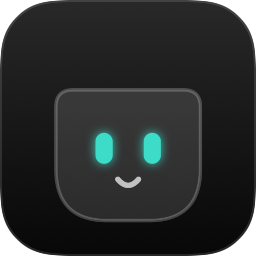

<h1 align="center">Xotch: the guide</h1>

  <strong>Your MacBook's notch, put to work.</strong> 
  An AI assistant, to-dos, music, calendar, timers, screenshots and Claude Code, one hover away.

  <a href="#get-the-beta"><strong>Get the beta</strong></a>
  &nbsp;·&nbsp;
  <a href="#features">Features</a>
  &nbsp;·&nbsp;
  <a href="#ask-ai-from-anywhere">Ask AI</a>
  &nbsp;·&nbsp;
  <a href="#light-on-your-battery">Performance</a>
  &nbsp;·&nbsp;
  <a href="#private-by-design">Privacy</a>
  &nbsp;·&nbsp;
  <a href="#questions">Questions</a>

  
  
  
  

  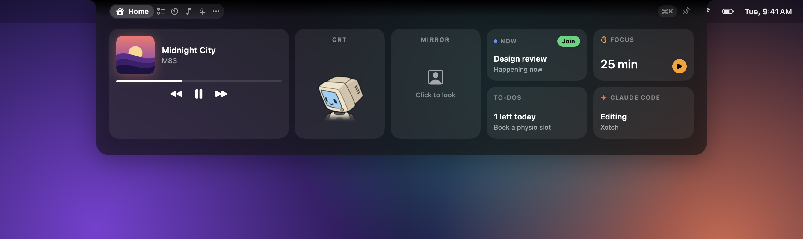

## Features

### In the notch

| | |
|---|---|
| **Home** | Live tiles: what's playing (or the time), the next meeting, the focus timer, to-dos and Claude |
| **AI** | Chat with a model on your Mac or with your own API key, ask about your screen, and keep a context like your resume |
| **To-dos** | Today, tomorrow and someday lists; unfinished ones carry over |
| **Now Playing** | Artwork, a dot-matrix track display, controls and a volume slider for any app playing audio |
| **Calendar** | The next 7 days, one-click Join for Zoom, Meet and Teams, and reminders |
| **Timers** | Focus sessions with breaks, countdowns, and a stopwatch with laps |
| **Clipboard** | Searchable, pinnable history as a row of cards, skipping password managers |
| **Shelf** | Drop files on the notch, then drag them out or AirDrop them |
| **Capture** | Screenshots and screen recordings with sound, kept on a shelf |
| **Notes** | A scratchpad and notes that save as you type |
| **System** | CPU, memory, network, disk and battery health |
| **Claude Code** | Today's tokens, your streak, and live session status |

### Around it

| | |
|---|---|
| **Beside the notch** | Timers, music, Claude, recordings, downloads and volume, shown without opening |
| **Shortcuts** | ⌘⇧Space asks the AI from any app; ⌘K opens a module, starts a timer, pauses music or adds a to-do |
| **Mirror** | Click the tile on Home to see yourself through the camera; it's off again when the notch closes |
| **Sounds** | Optional 8-bit blips and jingles, generated in code |
| **Any display** | Monitors without a notch get one drawn in the menu bar |

## Quiet until you need it

The first time Xotch opens, the notch says hello: the word writes itself in one line of white handwriting, like a new Mac, then three things to know. See it again from the menu bar's **Welcome to Xotch…**.

Move the pointer to the notch and it grows a little. Keep it there and Xotch opens, wide and short along the menu bar, with tabs for your first five modules beside the camera and the rest under ···. Click, and it stays open until you press Esc or click somewhere else. From any app, **⌘⇧Space** opens it straight onto the AI chat.

When the notch is closed and nothing is happening, Xotch uses no processor time at all.

## Ask AI, from anywhere

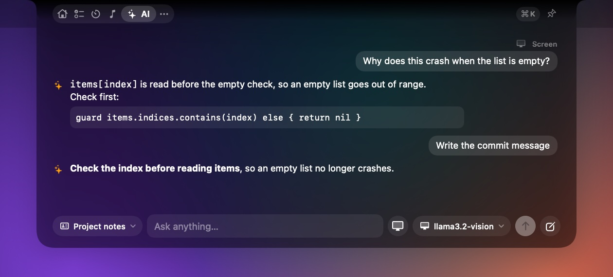

Press **⌘⇧Space** in any app and the notch opens on a chat, ready to type. Replies stream in as they're written, each in a card naming the model: the answer first, then headings, numbered steps, tables, Note and Tip callouts, and code coloured by language with line numbers. Under the last answer you can copy it, retry, or ask for it shorter or longer, and three suggested follow-up questions are a click away.

### Your choice of AI

Add one or more in **Settings › AI › Providers**:

| Provider | Needs |
|---|---|
| Ollama | Ollama running on your Mac. Nothing leaves it |
| OpenAI-compatible server | A URL: LM Studio, llama.cpp, Groq, OpenRouter and others. A key only if the server asks |
| OpenAI, Anthropic (Claude), Google Gemini | Your API key |

**Load List** fetches the models a provider offers, and **Test Connection** checks it answers before you rely on it. Switch provider or model any time from the chip beside the input. Keys are kept in your Keychain, never in Xotch's files.

### Ask about your screen

Press **⌘⇧↩** and Xotch takes the screen under the pointer first, then opens the chat with it attached, so you can ask about the code, the error or the slide in front of you. The screen button beside the input does the same from inside the notch. Xotch leaves its own notch out of the picture, and the screenshot is never saved.

Screen questions need a model that can see images, such as `llama3.2-vision` or `gemma3` in Ollama, or any current Claude, GPT or Gemini model.

### Keep a context

A context is background the AI keeps in mind: your resume, a job description, or notes on a topic you're preparing for. Paste it in or import a PDF, text or Markdown file in **Settings › AI › Context**, then pick one from the chip on the left of the input. It goes with every question until you choose **No context**.

### Let it use the notch

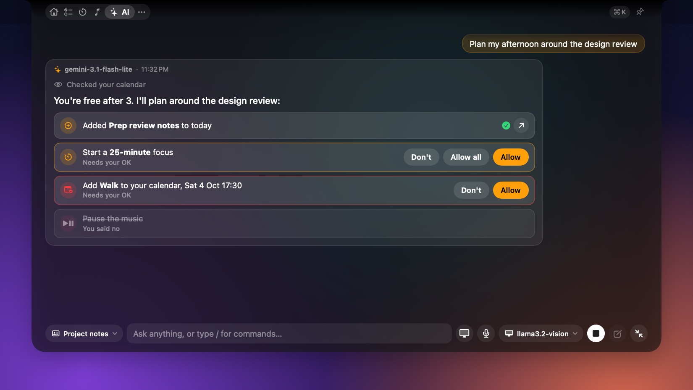

The AI can look at and change things in the notch for you: check today's to-dos, your calendar, the timer, what's playing or how your Mac is doing, and add to-dos, start a focus timer, write a note, add a calendar event, pause the music or take a screenshot. Ask for several things at once ("plan my afternoon") and it takes them one step at a time.

Looking things up just happens, shown as a quiet line in the answer. Anything that changes something, or shares your clipboard or notes, appears as a card that waits for **Allow** (or **Allow all** when there are several), and most changes can be undone from the card. Turn it off in **Settings › AI › Notch tools**. It works with Gemini, Claude, GPT and local models that support tools; others answer without them.

Type **/** in the chat for commands that run straight away without asking the AI: `/todo`, `/timer 25m`, `/focus`, `/break`, `/note`, `/play`, `/pause`, `/next` and `/clear`.

### Out of shared screens

**Settings › Privacy & Feedback › Hide the notch from screen sharing and recordings** asks macOS to leave the notch out of shared screens and recordings. Some apps and macOS versions capture it anyway, so check with a test call first.

## Talk instead of typing

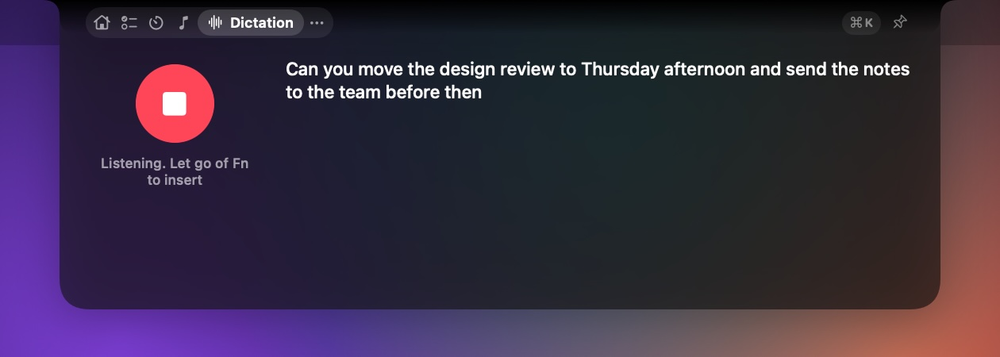

Hold **Fn** (🌐) anywhere and talk; let go and your words appear where you're typing, in Mail, Slack, Notes or a browser. Double-tap Fn to keep listening hands-free and press it again to finish; Esc cancels. While you talk, the notch shows a microphone and your voice as a moving waveform.

Speech is turned into text on your Mac by [Whistle](https://huggingface.co/Cactus-Compute/whistle) from Cactus Compute (Apache 2.0), a 17 MB model that hears English, German, French, Spanish, Italian, Dutch and Polish. Five seconds of speech take about 30 milliseconds. Your voice is never saved or sent anywhere. Xotch tidies the text a little (no "um"s, no repeated words, capitals and a full stop) and can ask your AI to polish it if you turn that on.

Set it up in **Settings › Dictation**: download the model once, allow the microphone and Accessibility, and add any names or jargon to **Words to listen for**. In macOS's Keyboard settings, set **Press 🌐 key to** "Do Nothing" so only Xotch answers. The **Dictation** page in the notch shows what's being heard and your recent dictations, and the microphone button in the AI chat dictates a question. Dictation needs a Mac with Apple silicon and macOS 26 or later.

## Beside the camera

When something is going on, the notch grows two small ears to show it without opening.

<table>
  <tr>
    <td align="center" width="50%"> <b>The mascot</b> sits in the left ear and watches your pointer</td>
    <td align="center" width="50%"> <b>Focus timer:</b> a ring fills as time passes</td>
  </tr>
  <tr>
    <td align="center"> <b>Music:</b> artwork, and bars that can follow the real sound</td>
    <td align="center"> <b>Claude Code:</b> a soft pulse while it works, a faster one when it needs you</td>
  </tr>
  <tr>
    <td align="center"> <b>Screen recording:</b> the time so far; click it to stop</td>
    <td align="center"> <b>Downloads:</b> how far along they are</td>
  </tr>
  <tr>
    <td align="center"> <b>Volume and brightness:</b> scroll on the notch, or use the keys once you turn on the setting</td>
    <td></td>
  </tr>
</table>

The mascot keeps the outer edge of the left ear. When something else is live, its icon moves to the right, next to its status. If several things are live at once, they take turns in the ear, six seconds each, and small dots show which one of the round you're seeing; click the right ear to skip to the next. A screen recording, or Claude waiting for your answer, stays put until it's done. In **Settings › Appearance › Companion** you can choose the mascot, or have nothing there.

### A mascot that watches you

Pick one of twelve characters (a fox, a cat, an astronaut, a CRT, …) and it sits in the left ear, turning its head to follow your pointer around the screen. A bigger one keeps you company on Home. Click it and it blinks, then sends a heart, a sparkle or a happy face; boop it four times quickly and it gets dizzy. The characters and how they move come from [page-mascot](https://github.com/nilbuild/page-mascot) by Kamran Ahmed (MIT licence).

The volume and brightness keys are off by default, because they need Accessibility permission. When the notch is open, the level shows in its header.

## Everything you reach for, in one place

<table>
  <tr>
    <td width="33%">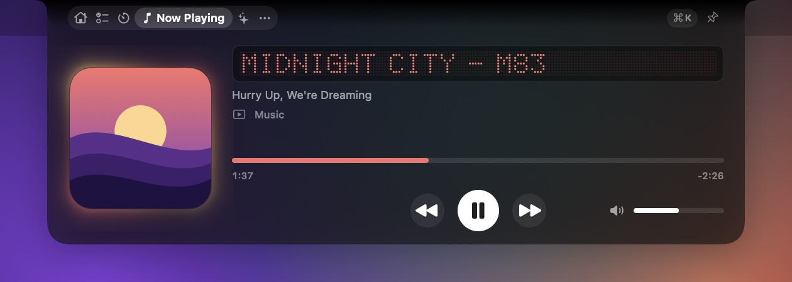</td>
    <td width="33%">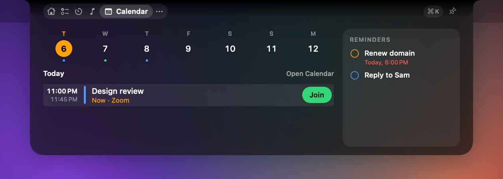</td>
    <td width="33%">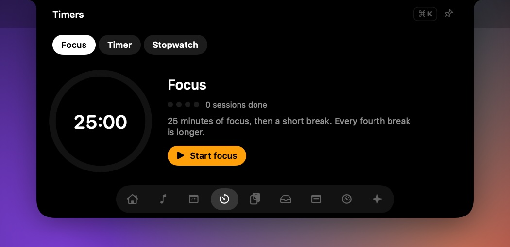</td>
  </tr>
  <tr>
    <td valign="top"><b>Now Playing</b> Artwork, a dot-matrix track display, controls and a volume slider for Music, Spotify, your browser, or any other app playing audio.</td>
    <td valign="top"><b>Calendar</b> The next 7 days, one-click Join for Zoom, Google Meet and Teams, and reminders you can tick off.</td>
    <td valign="top"><b>Timers</b> Focus sessions with breaks, countdowns, and a stopwatch with laps.</td>
  </tr>
  <tr>
    <td>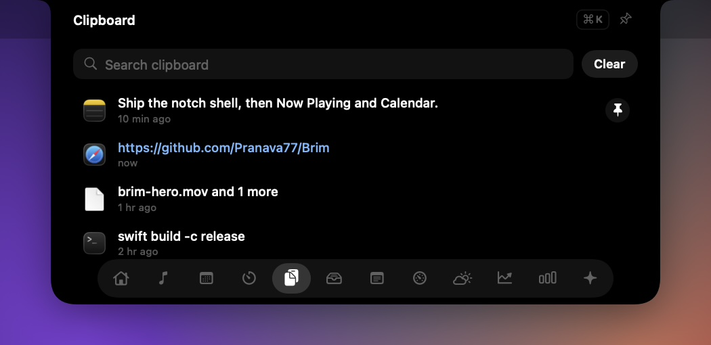</td>
    <td>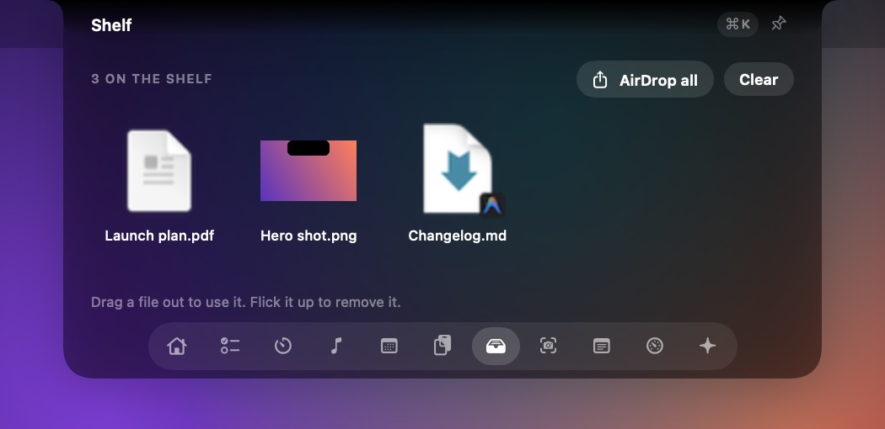</td>
    <td>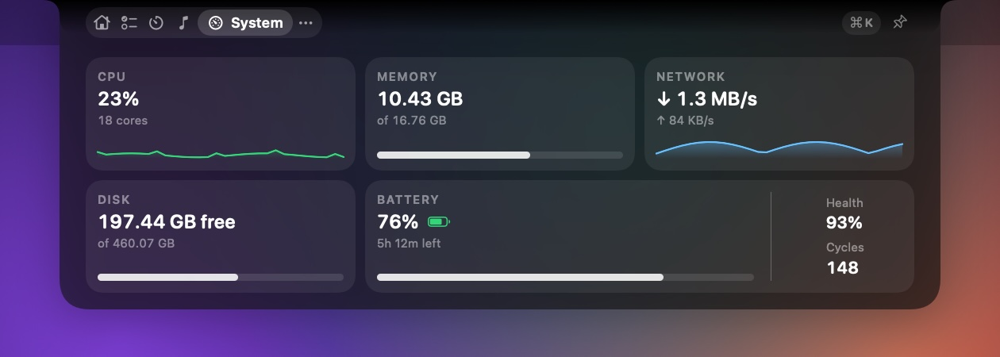</td>
  </tr>
  <tr>
    <td valign="top"><b>Clipboard</b> Everything you've copied as a row of cards, searchable and pinnable. Passwords from password managers are skipped.</td>
    <td valign="top"><b>Shelf</b> Drop files on the notch to keep them handy. Drag them out later, AirDrop them, or flick them away.</td>
    <td valign="top"><b>System</b> CPU, memory, network speed, disk space and battery health, updated only while you look.</td>
  </tr>
</table>

Home is a set of live tiles: what's playing (or the time when nothing is), the next meeting with its Join button, the focus timer, what's left to do today and Claude's status. Click a tile to open its module. Notes gives you a scratchpad that can sit beside the notch, plus notes that save as you type.

### To-dos

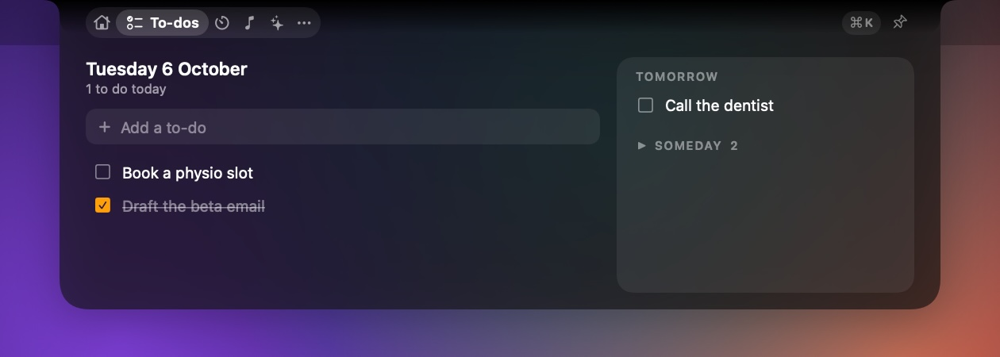

Today's to-dos on the left; tomorrow's and a someday list on the right. Type one straight into the notch, or press ⌘K anywhere and say what you're doing. Right-click a to-do to move it to today, tomorrow or someday. Anything you don't finish carries over to the next day instead of quietly disappearing.

### Screenshots and recordings

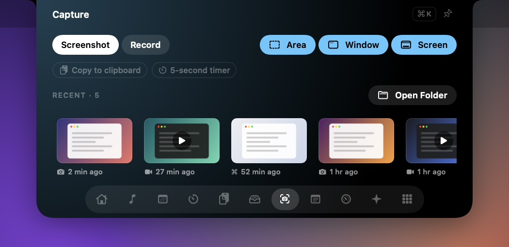

Take a screenshot of an area, a window or the whole screen, or record your screen with sound. Everything lands on a shelf in the notch, ready to drag into a message.

The shelf also picks up screenshots you take with **⌘⇧3**, **⌘⇧4** and **⌘⇧5**. Drag one out, AirDrop it, or flick it away.

Screenshots go to your clipboard as you take them, and are saved in **Pictures › Xotch**. Recording needs macOS 15.

 

### Claude Code, beside the notch

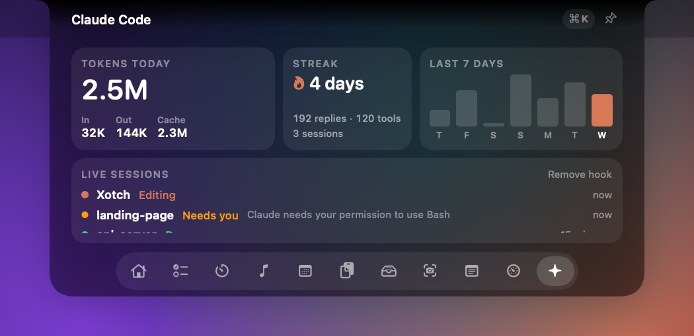

See today's tokens, replies and streak, read from Claude Code's logs on your Mac.

Add the hook and every session shows whether it's working, needs you, or is done, right next to the camera. You can leave Claude running and get on with something else.

 

## Keyboard and gestures

These work in any app:

| Shortcut | To |
|---|---|
| ⌘⇧Space | Open the AI chat, ready to type |
| ⌘⇧↩ | Ask the AI about your screen |

Turn either off in **Settings › AI › Shortcuts**. Hiding the AI module turns both off.

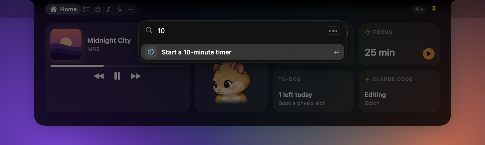

In the open notch, press **⌘K** and type:

| Type | To |
|---|---|
| `cal` | Open Calendar |
| `10 min` | Start a 10-minute timer |
| `pause` | Pause the music |
| `shot` | Take a screenshot |
| Something you copied | Copy it again |
| A question ending in `?` | Ask the AI |
| Anything else | Add it to today's to-dos, or ask the AI |

 

| To | Do this |
|---|---|
| Switch module | ⌘1 to ⌘9, or swipe sideways with two fingers |
| Change the volume | Scroll on the closed notch |
| Remove a file from the Shelf | Flick it upwards |
| Close | Esc, or click anywhere else |

## Make it yours

**The look** is macOS's own dark material, like Control Center: the open notch is translucent dark, so a hint of what's behind shows through, and the closed notch stays black so it blends in with the camera. Themes of Xotch's own will come later.

**The mirror** is a tile on Home. Click it and the camera comes on, flipped like a mirror, for a look before a call. Click again, switch tabs or close the notch and it's off; the camera never starts just because the notch opened. Turn the tile off in Settings › Appearance.

**Arcade sound effects** are short 8-bit blips for opening and closing the notch, switching modules, adding, finishing and deleting to-dos, and pinning, with a jingle for a finished timer or a celebration. They're generated in code, so no sound files ship with the app. They're off by default; turn them on in Settings › General, where there's a volume slider.

You can also reorder or hide any module, choose whether the notch opens on hover or on click, and pick which displays it appears on. Every screen gets one by default. A display without a notch gets one drawn in its menu bar, sized to the screen, so an external monitor, an iMac, a Mac mini or a Studio all work.

Settings is laid out like System Settings, with a sidebar of pages: General, Appearance, Modules, Media, To-dos & Timers, Shelf & Clipboard, Capture, AI, and Privacy & Feedback.

## Light on your battery

The budget is under 0.5% CPU and under 80 MB of memory while idle, with nothing working in the background while the notch is closed. Anything that only matters on screen, like system stats, pauses when you can't see it.

| State | CPU | Memory |
|---|---|---|
| Closed, nothing live | 0.00% | 18 MB |
| Closed, music bars | 0.00% | 41 MB |
| Closed, music bars following the real sound | 0.17% | 41 MB |
| Closed, Claude working | 0.00% | 42 MB |
| Closed, download progress | 0.00% | 47 MB |
| Closed, timer counting down | 0.44% | 42 MB |
| Closed, recording indicator | 0.42% | |
| Open on Home | 0.00% | 32 MB |
| Open on Now Playing | 0.10% | 38 MB |
| Open on Calendar, Clipboard or Shelf | 0.00% | 36 to 37 MB |
| Open on Timers | 0.10% | 44 MB |
| Open on System | 0.60% | 38 MB |
| Command palette | 0.10% | 54 MB |

Measured on a 14-inch MacBook Pro with an M5 Pro chip, macOS 26.6.2, averaged over about 10 seconds per state. Recording the screen with system audio costs Xotch about 1% more; macOS does the video encoding in its own processes, so that part doesn't count against Xotch. The mascot's breathing runs in Core Animation, so leaving it on doesn't wake Xotch up.

The AI chat does nothing until you send a message. A local model does its work in Ollama or LM Studio, not in Xotch, so that cost shows up in those apps.

The timer ring, the Claude pulse, the music bars and the confetti are Core Animation layers. The window server animates them, and Xotch itself stays idle. Each extra display gets its own notch, so memory goes up per screen: about 80 MB with a second, ultra-wide monitor attached. The full numbers, the fixes behind them and how to reproduce them are in [docs/PERFORMANCE.md](PERFORMANCE.md).

## Private by design

Xotch has no account and no analytics, and it doesn't connect to any online service unless you add a cloud AI provider. Your clipboard history, notes, to-dos and files stay on your Mac. With a cloud provider, only what you send in the AI chat goes to it: your messages, the context you've chosen, any screenshot you attach, and what the AI looks up in the notch to answer you (your clipboard and notes only after you click **Allow**). A local model through Ollama or LM Studio keeps even that on your Mac.

Screenshots and recordings are saved in Pictures › Xotch unless you choose another folder, and nothing is uploaded. When the music bars follow the real sound, Xotch only measures how loud it is and records nothing. Crash reports are never sent automatically: if you choose to keep them, you decide whether to email one.

<b>What Xotch asks permission for, and when</b>

 

Xotch asks only when you use something that needs it.

| Permission | When | Why |
|---|---|---|
| Calendars and Reminders | You choose **Allow** in Calendar | Your events and reminders |
| Notifications | You start your first timer | Telling you when time's up |
| Paste from other apps (macOS 26) | You choose **Allow** in Clipboard | Keeping your clipboard history |
| System audio recording | You turn on real sound for the music bars | Measuring how loud the music is |
| Screen Recording | Your first screenshot or recording in Capture, or your first screen question to the AI | Taking the picture. Choosing a window to record uses macOS's own picker instead, which needs no permission |
| Microphone | Your first dictation, or Capture › Microphone | Hearing what you dictate (turned into text on your Mac, never saved), or recording your voice with the screen |
| Desktop folder (may be asked) | Opening Capture, if it's listing your ⌘⇧3 and ⌘⇧4 screenshots | Finding those screenshots, which macOS saves to Desktop unless you've changed it |
| Downloads folder | macOS may ask when you turn on download progress | Showing how far downloads have got |
| Accessibility | Only if you turn on **Settings › Media › Show volume and brightness in the notch**, or dictation | Reading the volume, mute and brightness keys so the notch can show the level in place of macOS's popup; for dictation, noticing the Fn key and pasting what you said. Xotch reads only those keys and nothing else you type |

Without those settings, Xotch never asks for Accessibility or Input Monitoring. The AI shortcuts don't need it either.

## Get the beta

Xotch is in private beta. If you have an invite:

1. Unzip the download and drag **Xotch** to your Applications folder.
2. Open Xotch. If macOS says it can't check the app, open **System Settings › Privacy & Security** and choose **Open Anyway**. Beta builds aren't signed yet; releases will be.
3. Move the pointer to the notch. Xotch lives in the menu bar and has no Dock icon.

Xotch needs macOS 14 Sonoma or later, on Apple silicon or Intel, and it's at its best on a MacBook with a notch. A few features need newer versions: Liquid Glass needs macOS 26, music bars that follow the real sound need macOS 14.2, and screen recording needs macOS 15. Screenshots and screen questions to the AI work on all of them.

<b>Set up the AI</b>

 

Open the AI module and choose **Set Up in Settings**, or go to **Settings › AI** and choose **Add Provider**.

- **On your Mac with Ollama:** install [Ollama](https://ollama.com), then run `ollama pull llama3.2` in Terminal, or `ollama pull llama3.2-vision` to ask about your screen. Add an Ollama provider and choose **Load List**.
- **On your Mac with LM Studio:** download a model, start the server from LM Studio's Developer tab, and add an OpenAI-compatible provider at `http://localhost:1234/v1`.
- **In the cloud:** add OpenAI, Anthropic or Gemini and paste your API key, or an OpenAI-compatible provider for Groq or OpenRouter.

Choose **Test Connection** before saving. The provider marked in the list is the one the chat uses.

<b>Connect Claude Code</b>

 

Usage stats work straight away, from Claude Code's logs on your Mac.

For live status, press **Add hook** in the Claude Code module. Xotch backs up `~/.claude/settings.json`, then adds a small entry so Claude Code can tell Xotch what it's doing. **Remove hook** takes that entry out again.

## Questions

<b>The notch disappeared.</b>

Xotch steps aside while an app is full screen. To keep it, turn off **Settings › General › Hide the notch while an app is full screen**. ⌘⇧Space still brings it back over a full-screen app.

<b>The AI says it can't reach Ollama or my server.</b>

Open the Ollama app, or run `ollama serve` in Terminal. For LM Studio, start the server in its Developer tab. Then choose **Try Again** in the chat.

<b>⌘⇧Space or ⌘⇧↩ does nothing.</b>

Check both are on in **Settings › AI › Shortcuts**, and that the AI module isn't hidden in **Settings › Modules**. If Settings says another app already uses the shortcut, turn it off in that app, then switch Xotch's off and on again.

<b>The AI can't see my screen.</b>

Allow Xotch under **System Settings › Privacy & Security › Screen & System Audio Recording**, then quit Xotch and open it again. The model also has to understand images: `llama3.2-vision` or `gemma3` in Ollama, or any current Claude, GPT or Gemini model.

<b>macOS keeps asking to let Xotch use the Keychain.</b>

That's where your API keys are kept. Beta builds aren't signed yet, so macOS can ask again after an update; choose **Always Allow**. Signed releases won't keep asking.

<b>Now Playing is empty.</b>

Start playing something. If Xotch says Now Playing isn't available, choose **Try again**.

<b>My clipboard history is empty (macOS 26).</b>

Open Clipboard and choose **Allow**. Then set Xotch to always allow under **Paste** in **System Settings › Privacy & Security**.

<b>The music bars don't follow the music.</b>

Allow Xotch under **System Settings › Privacy & Security › Screen & System Audio Recording**, or turn real sound off in Settings to keep the built-in animation.

<b>I don't have a notch.</b>

Then Xotch draws one. On a Mac without a notch (an iMac, a Mac mini, a Studio, an older MacBook) and on any external monitor, it draws a notch in that screen's menu bar, sized to the screen, and everything works the same. By default every display gets one; **Settings › General › Displays** can narrow that to a single screen.

<b>The notch slides across when I change desktop.</b>

macOS slides every window sideways as desktops change, and it won't let an app opt a window out. The notch is pinned to all desktops and still gets moved; it lands back in place when the animation finishes.

To stop it, turn on **System Settings › Accessibility › Display › Reduce motion**. Desktops then change without the sliding animation.

<b>My screenshots only show the wallpaper.</b>

macOS hasn't given Xotch permission yet. Allow Xotch under **System Settings › Privacy & Security › Screen & System Audio Recording**, then quit Xotch and open it again.

<b>Where do my screenshots go?</b>

To **Pictures › Xotch**, and to your clipboard. Choose another folder in **Settings › Capture**, or press **Open Folder** in the Capture module.

<b>I don't see download progress.</b>

Turn on **Settings › Shelf & Clipboard › Show download progress beside the notch**. Progress appears for apps that report it to macOS, such as Safari and Chrome.

<b>⌘K or ⌘1 to ⌘9 does nothing.</b>

Click the notch first, so Xotch receives your keyboard input.

<b>macOS asked for Calendar access again after an update.</b>

Beta builds aren't signed yet, so macOS can ask again. Signed releases won't.

<b>How do I uninstall Xotch?</b>

1. If you added the Claude Code hook, press **Remove hook** in the Claude Code module.
2. Remove your AI providers in **Settings › AI**, which deletes their keys from the Keychain. Or delete the items named **Xotch AI key** in Keychain Access afterwards.
3. Quit Xotch from the menu bar icon and move it to the Trash.
4. To remove everything else, delete `~/Library/Application Support/Xotch` and `~/Library/Preferences/com.pranava.xotch.plist`.

## Feedback

Choose **Send Feedback…** from the menu bar icon. It opens an email with your Xotch and macOS versions filled in.

 

Building Xotch from source? See <a href="DEVELOPMENT.md">docs/DEVELOPMENT.md</a>.

